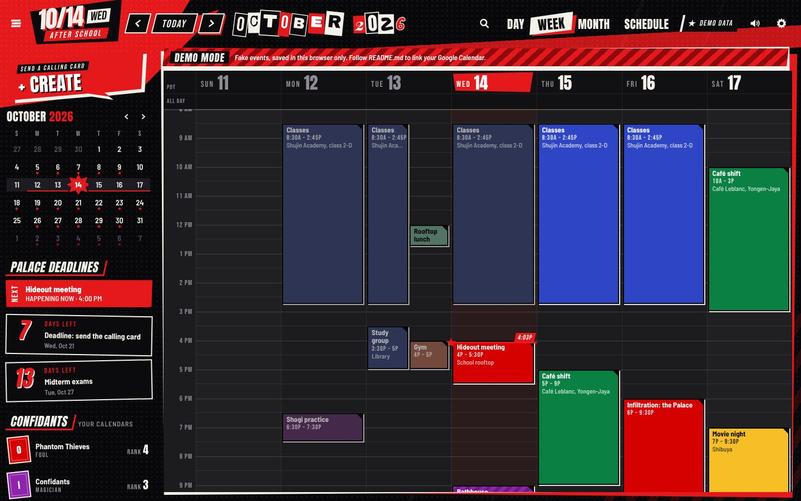
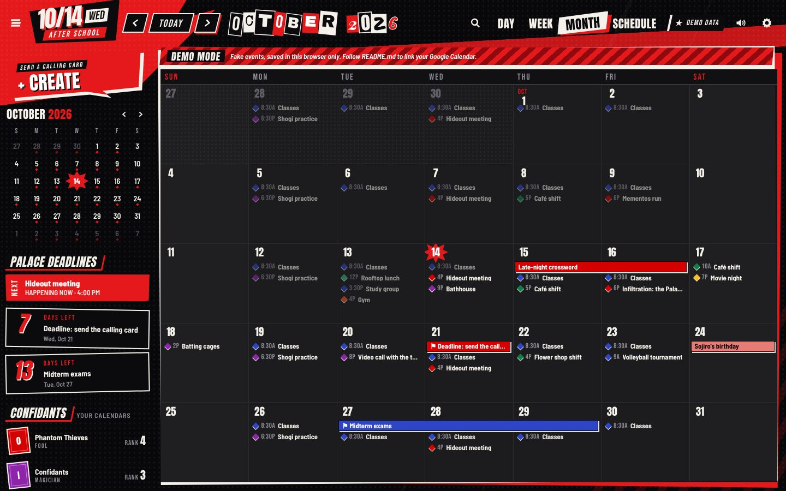
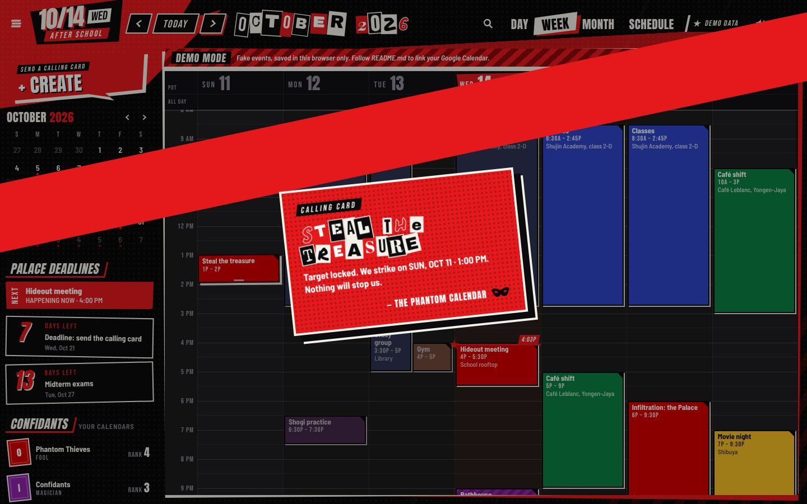
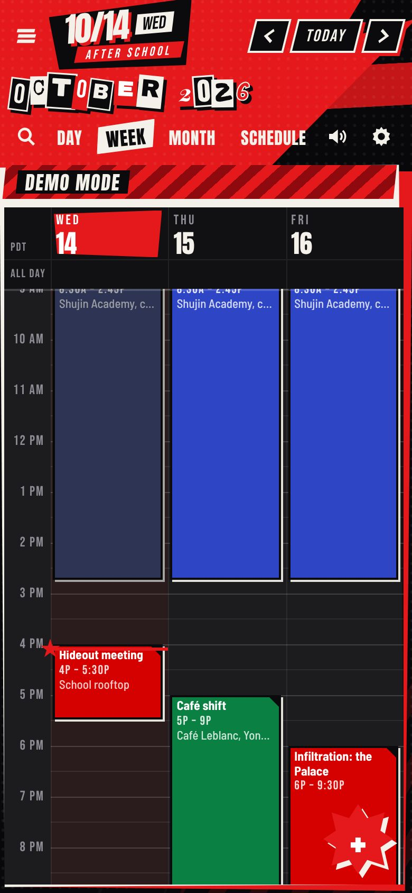

# PHANTOM CALENDAR

**Your Google Calendar, styled like a Phantom Thieves heist.** Red, black and paper-white.
Ransom-note headlines. Every new event arrives as a calling card. When an event starts,
the screen yells **IT'S SHOWTIME!**

It's a real calendar too. Day, week, month and schedule views. Drag to create, move and
resize events. Repeating events, search, colours, notifications. And it's **two-way**:

- Change something in the app and it's saved to Google Calendar straight away.
- Change something in Google Calendar (on your phone, on the website, or when someone
  invites you) and it shows up in the app within 30 seconds. It also checks the moment
  you switch back to the tab. [How syncing works](#how-syncing-works)



| Month | Calling card | Phone |
|---|---|---|
|  |  |  |

> Fan-made and unofficial. It isn't affiliated with ATLUS or SEGA, and it contains no game
> artwork. Every shape is drawn in code, and the fonts are free Google Fonts.

---

## Try it first (no setup)

Download **[the app file](https://github.com/MAggiSupporter/Maggi/blob/claude/epic-thompson-258mz9/phantom-calendar/apps-script/Index.html)** with the **Download raw file** button (the ⬇ arrow at
the top right), then double-click it. It opens in your browser in **demo mode**: fake events,
saved only in that browser, never sent anywhere.

---

## Link it to your Google Calendar (about 5 minutes, no coding)

The app lives inside **your own Google account**, using Google Apps Script, Google's free
tool for small apps. You copy **one** block of text, paste it into Google, and press a few
buttons. Nothing to install, no keys, no servers.

Do this on a **computer** (copying and pasting on a phone is painful). Afterwards you can
use the app on your phone too.

### Step 1: Copy the code

1. Open this link: **<https://raw.githubusercontent.com/MAggiSupporter/Maggi/claude/epic-thompson-258mz9/phantom-calendar/apps-script/Code.gs>**
2. It's a page full of code. You don't need to read it. Press **Ctrl+A** (Mac: **⌘+A**) to
   select it all, then **Ctrl+C** (Mac: **⌘+C**) to copy it.

### Step 2: Paste it into Google

1. Go to **<https://script.google.com>** and sign in with the Google account whose calendar
   you want to use.
2. Click **New project** (top left).
3. You'll see a little bit of code (`function myFunction() { }`). Click inside it, press
   **Ctrl+A** (Mac: **⌘+A**) to select it, then **Ctrl+V** (Mac: **⌘+V**) to paste over it.
4. Press **Ctrl+S** (Mac: **⌘+S**) to save. If it asks for a project name, type
   **Phantom Calendar**.

### Step 3: Switch on Google Calendar for it

1. On the left, find the word **Services** and click the **+** next to it.
2. Click **Google Calendar API** in the list, then click **Add**.

### Step 4: Turn it into an app

1. Click the blue **Deploy** button (top right), then **New deployment**.
2. Click the ⚙️ gear next to **Select type** and choose **Web app**.
3. Set **Execute as** to **Me**, and **Who has access** to **Only myself**.
4. Click **Deploy**.

### Step 5: Say yes to Google

1. Click **Authorize access**, then pick your Google account. (If nothing happens, your
   browser blocked a pop-up. Allow pop-ups for script.google.com and click it again.)
2. Google warns **"Google hasn't verified this app"**. That's normal: you just made this app
   yourself and it isn't published anywhere. Click **Advanced**, then **Go to Phantom Calendar
   (unsafe)**.
3. Google lists what the app may do. **Tick every box** (or **Select all**), then click
   **Continue** or **Allow**. Google's wording sounds scary ("see, edit, share, and
   permanently delete all the calendars…"). That's Google's standard sentence for *any*
   calendar app. This one only creates, changes and deletes the events you tell it to.

### Step 6: Open your app 🎉

1. Google shows a **Web app** link ending in `/exec`. Click **Copy**, paste it into your
   browser's address bar and press Enter.
2. **Bookmark it.** That link *is* your app, and only you can open it.
3. **On your phone:** open the same link in Chrome or Safari, signed in to the same Google
   account, and choose **Add to Home Screen**.

> **Want everything stored inside your account?** By default the app's screens download from
> this GitHub page each time you open it, which is how you get fixes automatically. To keep a
> fixed copy instead: in the Apps Script editor click **+** next to **Files** → **HTML**, name
> it `Index`, and paste in [the app file](https://github.com/MAggiSupporter/Maggi/blob/claude/epic-thompson-258mz9/phantom-calendar/apps-script/Index.html) (use **Copy raw file**). Then do
> Deploy → Manage deployments → ✏️ → Version: **New version** → Deploy.

---

## How syncing works

There is only **one** copy of your calendar: the one in Google. Phantom Calendar is just a
different-looking window onto it.

- **You add, move or delete something in Phantom Calendar** → it's saved to Google
  Calendar straight away. Google's own app and website will show it next time they refresh
  (usually seconds).
- **You add, move or delete something in Google Calendar** (on your phone, on the website,
  or someone invites you) → Phantom Calendar picks it up within **30 seconds** while it's
  open, and immediately when you come back to its tab. Press **R** to check right now.
- **Phantom Calendar is closed** → nothing is lost. Everything is in Google, and the app
  shows it all next time you open it.
- **Same event changed in both places at once** → the change saved last wins.

A few things only Google's own apps can do: invite guests, add a Meet link, and answer
invitations (yes/no/maybe). Reminders you set in Phantom Calendar are delivered by Google's
own apps, like any other Google Calendar reminder.


## What it does

| | |
|---|---|
| **Views** | Day, week, month and schedule. On a phone, the week view shows 3 days at a time. |
| **Create** | Click an empty slot to make a 1-hour event. Drag down across slots to make a longer one. In month view, click a day to make an all-day event. The big **CREATE** button opens the full editor. |
| **Change** | Drag an event to move it, or drag its bottom edge to change when it ends. Each change gives you an **UNDO** button. On a phone, press and hold an event, then drag it. |
| **Repeating events** | When you change one, you choose **just this event** or **all events in the series**. Moving a weekly event to another day updates the rule, so "weekly on Tuesday" becomes "weekly on Wednesday". |
| **Details** | Location (opens Google Maps), video call link, guests and who said yes, description with clickable links, notifications. |
| **Editor** | Title, dates and times, all day, repeat, location, details, calendar, colour, notification, busy/free. |
| **Palace Deadlines** | Tick **Palace Deadline** on an event (or put "deadline" or "due" in its title) and the side panel counts down the days. The flag is saved on the Google event itself. |
| **Confidants** | Your calendars, each with a tarot arcana and a **rank** based on how busy it is this month. Click one to hide or show it. Read-only calendars (like holidays) are marked. |
| **Search** | Searches your calendars from a year ago to two years ahead. |
| **Calling cards** | Every new event gets one. Tap anywhere and it gets out of your way. |
| **SHOWTIME** | A cut-in banner when an event starts while the app is open. |
| **Themes** | Joker (red), Skull (yellow), Panther (pink), Oracle (green), Velvet Room (blue and gold), Crow (light mode). |
| **Extras** | Sound effects made in code (no audio files), an optional weather icon on each day, a 12- or 24-hour clock, and your choice of Sunday, Monday or Saturday as the first day of the week. |

**Keyboard shortcuts:** `C` create, `T` today, `D` `W` `M` `A` day/week/month/schedule,
`J`/`K` or `←`/`→` next/previous, `/` search, `R` check Google now, `E` edit the open event,
`Del` delete it, `S` sound, `Esc` close, `?` show the list.

Settings live in **the Hideout** (⚙️, top right) and are saved to your Google account, so
your phone and computer match.

---

## Updating to a newer version

Mostly you don't have to: the app's screens download fresh from GitHub each time you open
it. Only if `Code.gs` itself changes (it's rare, and the README will say so):

1. Copy the new code from the Step 1 link and paste it over the old code. Press **Ctrl+S**.
2. Click **Deploy → Manage deployments**, click the ✏️ pencil, set **Version** to
   **New version**, and click **Deploy**. Your link stays the same.


## If something goes wrong

- **A screen says "ONE MORE STEP".** You skipped Step 3. Do it, then click **Deploy → Manage
  deployments**, the ✏️ pencil, **Version: New version**, **Deploy**, and reload the app.
- **A screen says "SECURITY ALERT" and mentions permission.** A box was left unticked in
  Step 5. In the Apps Script editor, pick **pcBootstrap** in the list next to **▷ Run** at the
  top, click **Run**, then **Review permissions**, tick every box and allow. Reload the app.
- **"Sorry, unable to open the file at present"** (or "…at this time"), or a blank page.
  You're probably signed in to **several Google accounts** at once (a known Google problem).
  Open the link in a private/incognito window (Chrome: **Ctrl+Shift+N**, Mac: **⌘+Shift+N**)
  and sign in only to the account you used in Step 2. Also check you copied the **Web app**
  link: it starts with `https://script.google.com/macros/s/` and ends with `/exec`. You can
  copy it again from **Deploy → Manage deployments**.
- **"Script function not found: doGet".** The code wasn't saved, or not all of it was
  pasted. Redo Steps 1 and 2 and press **Ctrl+S**, then publish a new version (see above).
- **"Couldn't download the app."** The app's screens come from GitHub, so you need to be
  online the first time. After that it keeps a copy and works even if GitHub is down.
- **Something you changed in Google hasn't appeared.** Press **R**, or click the **SYNCED**
  chip at the top. In the Hideout (⚙️) you can make it check every 15 seconds.
- **A calendar's events are missing.** Its card under **CONFIDANTS** is probably faded,
  which means hidden. Click the card to show it.
- **Dragging doesn't work on some events.** Holiday calendars, calendars shared with you
  read-only, and invitations from other people can't be changed here.
- **On an iPhone, the Home Screen icon asks you to sign in again.** Home Screen apps keep
  their own sign-in. Sign in once, or delete the icon and add it again with **Open as Web
  App** switched off.
- **You want to remove the app's access.** Go to **<https://myaccount.google.com/permissions>**
  and remove **Phantom Calendar**. You can also just delete the project at script.google.com.

---


## Privacy

Everything stays between you and Google. The code that touches your calendar is
`Code.gs`, which you can read, and it runs inside your Google account. The app uses no
server of its own and has no tracking. Besides Google, it contacts GitHub (to download its
screens, unless you added your own `Index` file), Google Fonts (for the lettering), and,
only if you turn weather on, Open-Meteo, which receives the city name you type.

---

## For tinkerers

`apps-script/Code.gs` is the only file people need to paste: it carries a small loader page
(`apps-script/loader/Index.html`, copied in by the build) that downloads the full app from
this repo, falls back to a fixed commit, and keeps a copy for offline use.

The app's source is in `src/`: `index.html`, `styles.css`, and `js/`. The JavaScript is split
into utilities, effects, the Google/demo connection, state and sync, views, dialogs and
start-up. `apps-script/Index.html` is built from it into one file:

```
node tools/build.mjs        # rebuild apps-script/Index.html after editing src/
npm install                 # once; then: npx playwright install chromium
npm test                    # end-to-end tests in a real browser (needs Node 18+)
```

If you use [clasp](https://github.com/google/clasp), `apps-script/` is a ready project folder:
its `appsscript.json` already turns on the Calendar service and sets up the web app.

`tests/google-path.test.js` runs the real `Code.gs` against a fake Google Calendar and
drives the real app in Chromium. It covers creating, moving, resizing, repeating events,
read-only calendars, error rollback, and changes made in Google showing up in the app.
`tests/demo.test.js` covers the rest, including phone touch gestures. You can pass it a
time zone, for example `node tests/demo.test.js Asia/Kolkata`.
